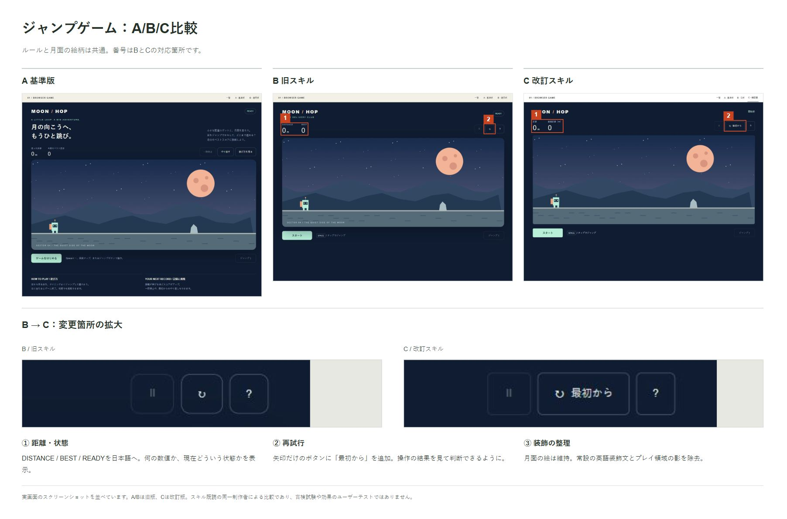
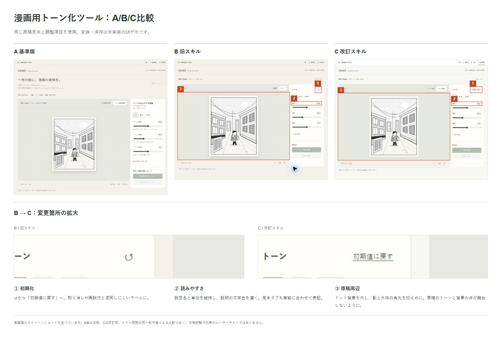
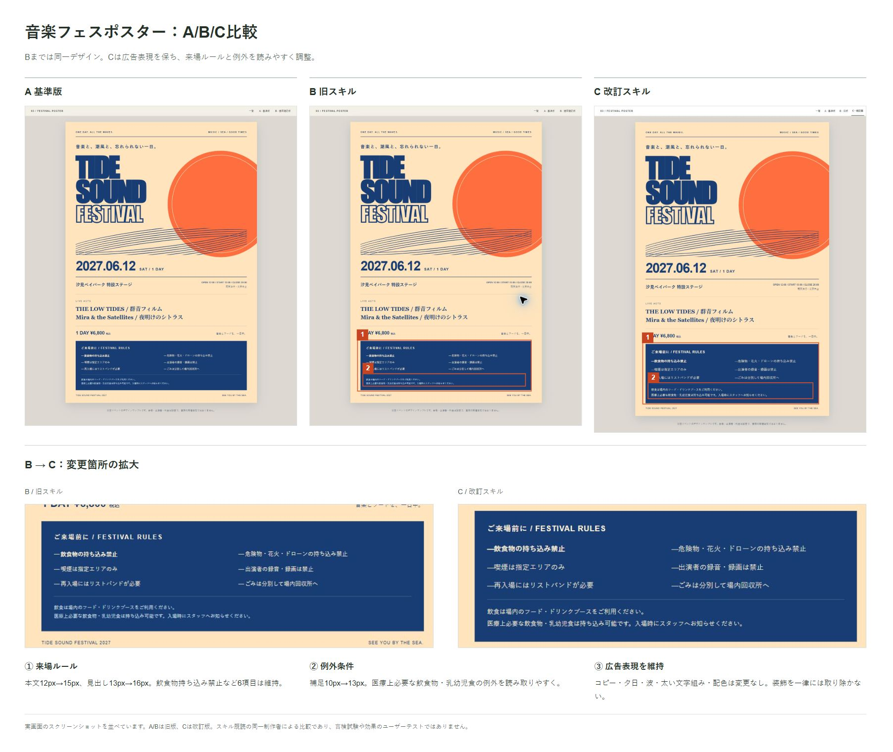

# ui-copy-and-controls

Codex向けの日本語スキルです。UIの文言・コントロール・装飾を、画面で担う役割に照らして選びます。

文字数や装飾の少なさを目標にせず、必要な設定名・単位・出力形式・注意事項を残します。LPや広告の強いコピー、世界観を担う表現は一律に削除しません。

## 対象

- ゲーム、編集ツール、設定・ヘルプなどの操作画面
- 一覧・比較・完了画面など、主画面に付随するページ
- LPや広告内の操作案内、判断に必要な情報

角丸・配色・書体など、特定の見た目を一律に禁止するスキルではありません。

## 使い方

1. このリポジトリを取得します。
2. Codexのユーザースキルディレクトリ `~/.codex/skills/ui-copy-and-controls/` に `SKILL.md` を配置します。
3. UIの制作・修正依頼で `$ui-copy-and-controls` を指定します。

例：

> $ui-copy-and-controls を使い、漫画編集ツールの画面を整理してください。原稿を中心にし、線数・濃度・角度と保存形式は分かるように残してください。

自動選択時にも適用対象を判断できるよう、SKILL.mdのdescriptionに対象を記載しています。

## A/B/C比較

- **A**：スキル未使用を意図した基準版
- **B**：旧スキルの適用版
- **C**：周辺ページ、装飾の役割、広告表現の維持を明確にした改訂版

これらはスキル既読の同一制作者による設計比較です。独立した盲検実験ではなく、利用者の理解度や作業時間の改善を実証するものではありません。

### ジャンプゲーム

状態を日本語で表示し、再試行に「最初から」を付けました。月面の絵柄とゲームルールは共通です。

### 漫画用トーン化ツール

初期化の意味を明示し、文字色と原稿周辺の装飾を整理しました。画像変換・保存は未実装のUIデモです。

### 音楽フェスポスター

広告コピーとビジュアルは維持し、来場ルールと持ち込み例外の文字を大きくしました。架空イベントのデザインサンプルです。

## ファイル

- `SKILL.md`：スキル本体
- `*-abc.jpg`：比較例（B→Cの変更箇所に印と説明）

## 検証範囲

改訂時にLP・比較一覧・編集ツール・ポスターの判断を独立エージェントで確認し、制作例はPC・スマホ相当の幅で検査しました。実機・Safari・利用者テストは未実施です。
