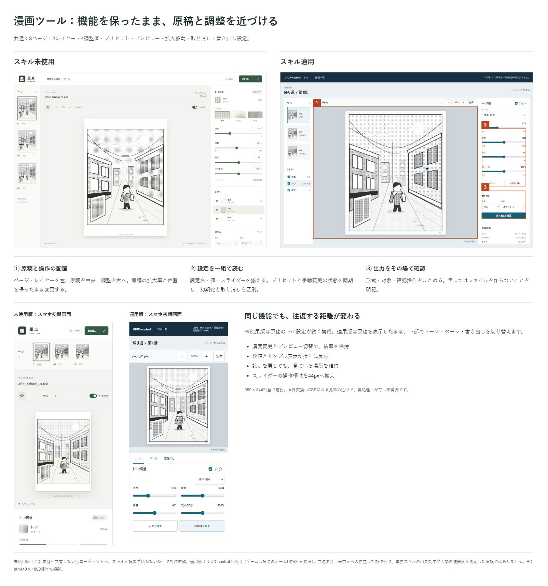
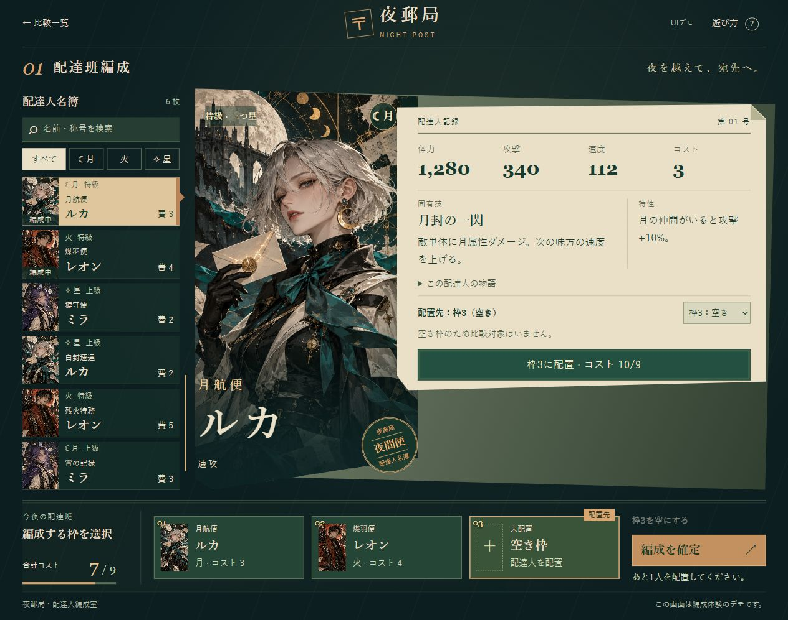
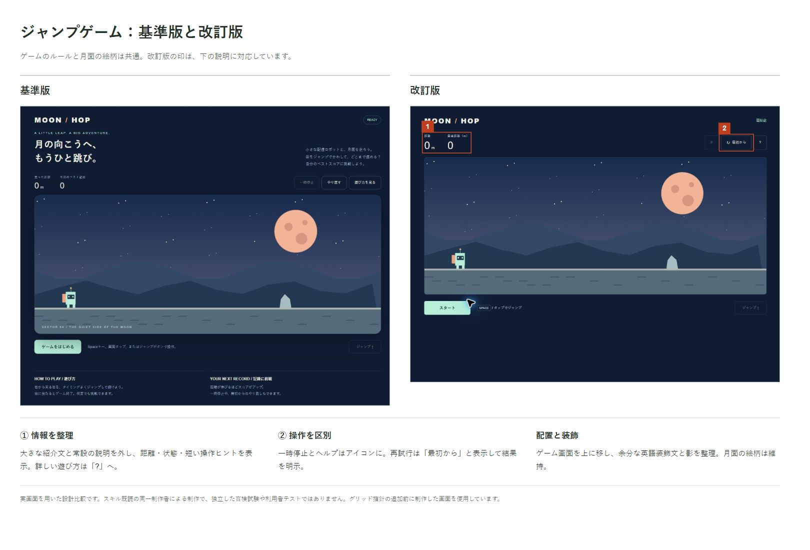

# AIに作らせた画面、なんか使いにくい。

**UIUX-control — どこを触るか、何が変わったか、次に何をするかが分かる画面へ。**

同じ機能要件と素材から制作した比較例です。未使用版は会話履歴を共有しない別エージェントが制作。適用版には追加の検証・修正も含まれ、スキルだけの効果を測定した実験ではありません。[制作条件を見る](examples/README.md)

[操作デモを試す](https://sunahaya-lab.github.io/UIUX-control/examples/) · [導入方法](#使い方) · [スキル本文](SKILL.md) · [4条件の比較](https://sunahaya-lab.github.io/UIUX-control/experiments/game-four-conditions/)

調整するたびに結果までスクロールする。説明は多いのに、どこを押せばいいか分からない。押しても、効いたのか分からない。

UIUX-controlは、そんな操作の迷いを減らすための設計スキルです。文言・配置・操作・ヘルプに加え、美術素材と状態演出も一緒に設計します。豪華な画面では、素材の出力リストと共通の美術仕様からimagegenによる生成へつなぎ、選択・決定・戻るときの触り心地まで確認します。特定の配色や角丸を禁止せず、必要な説明や作品の世界観は残します。

**Codexで制作・検証。Claude Code向けの導入手順も掲載しています（形式互換を確認、Claude Codeでの実行は未検証）。** スキル本文は日本語です。

### English summary

AI-built interfaces can look finished yet remain hard to use. UIUX-control combines composition, asset planning, image-generation handoff, interaction states, motion, and contextual help without prescribing one visual style.

The comparison above uses the same feature brief and assets; it is an illustrative example, not a controlled estimate of the skill's effect. Developed with Codex; Claude Code installation follows its documented skill format but has not been runtime-tested. Skill instructions are currently in Japanese.

## 新しい制作例：夜郵局

装飾や情報が豊かなカード編成画面を、主役・まとまり・動きから設計しました。[未使用版と改訂版を操作する](https://sunahaya-lab.github.io/UIUX-control/examples/night-post/)

両版は同じ人物画とカード情報を使用。改訂版には初稿の表示確認後の再設計を含みます。[制作条件・検証範囲](examples/night-post/README.md)

## 使い方

`SKILL.md` と `references/` フォルダを、次の場所へ配置します。

| ツール | 配置先 | 呼び出し方 | 確認範囲 |
|---|---|---|---|
| Codex | `~/.codex/skills/uiux-control/` | `$uiux-control` | このリポジトリの制作で使用 |
| Claude Code | `~/.claude/skills/uiux-control/` | `/uiux-control` | 公式の形式・配置方法と照合。実行未検証 |

Claude Codeでは、プロジェクト限定で `.claude/skills/uiux-control/` に配置する方法もあります。`name`・`description` を持つ `SKILL.md` と補助ファイルという構成は、[Claude Codeの公式スキル仕様](https://code.claude.com/docs/en/skills)に沿っています。

Codexでの依頼例：

> $uiux-control を使い、漫画編集ツールの画面を整理してください。原稿を中心にし、線数・濃度・角度と保存形式は分かるように残してください。

Claude Codeでは先頭を `/uiux-control` に替えて依頼します。自動選択のための適用対象も、スキルのdescriptionに記載しています。

### imagegenとの連携

素材制作が必要な場合は、[素材制作と状態演出](references/assets-and-motion.md)に沿って、出力リスト・共通の美術仕様・状態表を作り、利用可能なimagegenスキルと画像生成ツールへ渡します。UIUX-control自体に画像生成エンジンやAPI接続は含まれません。Claude Code等で生成手段が用意されていない場合は、既存素材を使うか、生成指示と必要素材の一覧までを作成します。

絵や材質は画像に、可変の文字・数値・色反転・入力への反応は実装に分けます。画像だけで完成画面を作って操作を後付けせず、最終表示と反復操作で確認します。

## スキル未使用版と適用版の制作事例

[操作デモを開く](https://sunahaya-lab.github.io/UIUX-control/examples/) · [共通の機能要件・制作条件・検証範囲](examples/README.md)

機能の多い漫画ツールとゲーム画面を、同じ機能要件と素材から制作しました。未使用版は、**会話履歴を共有しない別エージェントに、スキルを一切読まず・使わずに制作するよう依頼**しています。比較のために意図的に使いにくくしたり、完成後に見た目を悪くしたりしていません。

適用版ではUIUX-controlを制作指針とし、ゲームでは補助のゲームUI指針も参照しました。独立したデザイン案の比較であり、単独スキルの因果効果や、人間の理解度・操作時間を測定した実験ではありません。

### 漫画原稿・トーン調整

3ページ・3レイヤー・4調整値・プリセット・プレビュー切替・拡大移動・取り消し・書き出し設定を両版に用意。適用版では原稿と調整を近づけ、スマホでも原稿を残したまま設定を切り替えます。

比較画像はREADME冒頭に掲載しています。

### MOON HOP

距離・シールド・エネルギー・鉱石・コンボ・チェックポイント・ミッション・装備・停止・結果・設定を両版に用意。適用版では状態と操作をまとめ、終了時は結果と再挑戦を中心に表示します。

### 試せる範囲

漫画ツールはCSSによるサンプルの表示近似で、実画像変換・ファイル保存は行いません。ゲームはジャンプの動作、装備、パネル開閉、状態切替のUIデモで、移動・衝突・音声は省略しています。

ローカルで動かす場合はリポジトリを取得し、ルートで `python -m http.server 8000` を実行して `http://localhost:8000/examples/` を開いてください。

## 他スキルとの切り分け（探索比較）

[4条件の操作デモと観察結果](https://sunahaya-lab.github.io/UIUX-control/experiments/game-four-conditions/) · [共通依頼文・条件・測定値](experiments/game-four-conditions/README.md)

スキルなし／UIUX-controlのみ／ゲームUI指針のみ／両方を、履歴共有なし・同じ要件と素材・実装1回で各1本制作しました。納品後のコードは修正せず、停止・終了の表現や画面の収まりを観察しています。各1本のため、寄与率・優劣・併用効果は断定していません。

## 対象

- ゲーム、編集ツール、設定・ヘルプなどの操作画面
- 一覧・比較・完了画面など、主画面に付随するページ
- LPや広告内の操作案内、判断に必要な情報

角丸・配色・書体など、特定の見た目を一律に禁止するスキルではありません。

## UX方針

- 目的の操作を探しやすくし、今決める必要のない設定まで判断させない。
- 同じ意味の状態表示・説明・操作名を同じ画面で繰り返さず、明瞭なボタンに不要な説明を添えない。
- 調整と結果確認の往復を減らし、倍率・位置・選択を保つ。
- 重い画像調整では軽量プレビューを追従させ、操作後に精細化する。プレビュー切替と設定のリセットを区別する。
- 状態・結果・次の操作を伝え、失敗理由と復帰方法を示す。
- 慣用アイコンや既習操作を活かし、反復クリック・無理な同時押し・持ち替えを減らす。
- PCの狭い参照ウィンドウ、編集画面、スマホなど、実際の作業環境で考える。

詳細は [UX方針](references/ux.md) にまとめています。以下の制作事例で操作と表示を確認していますが、利用者テストや個別の指針の効果測定は行っていません。
- 必要な文字を縮めて画面に詰め込まず、実際に読まれる大きさで確認する。
- ルールや用語はヘルプへ、現在の状態や判断に必要な条件は操作の近くへ置く。
- 利用者や環境の違いを考慮し、サービスの目的に合う代替操作・情報伝達を検討する。

## 情報整理の4原則

- **近接**：同じ判断に使う情報と操作を近づける。
- **整列**：基準線を揃え、読む順序と対応関係を示す。
- **反復**：同じ役割の表現と操作規則を揃える。同じ説明の重複とは区別する。
- **対比**：主情報と補足、主要操作の優先度を示す。

同じ画面に収まっていても、関連情報を探して左右上下へ何度も視線を動かす構成は見直します。

## グリッドデザイン

列・余白・整列の基準を共有して、主役・操作・補足の関係を作ります。均等なカードや固定の列数を押し付けず、原稿と設定に必要な幅を割り当て、狭い画面でも読む順序を保ちます。LPやポスターの意図的な非対称やはみ出しは、訴求の役割があれば維持します。

## ファイル

- `SKILL.md`：スキル本体
- `references/ux.md`：UXの判断指針
- `examples/`：2題材のスキル未使用版・適用版、制作条件
- `game-comparison.jpg` / `tone-comparison.jpg`：注釈付き比較画像
- `poster-comparison.jpg`：以前制作した広告表現の参考比較

## 検証範囲

JavaScript構文、ローカル参照、PCとスマホ相当の表示、プレビュー切替・取り消し・初期化・装備・状態切替を確認しています。実機、Safari、スクリーンリーダー、利用者テストは未実施です。操作デモは完成アプリの代替ではありません。
