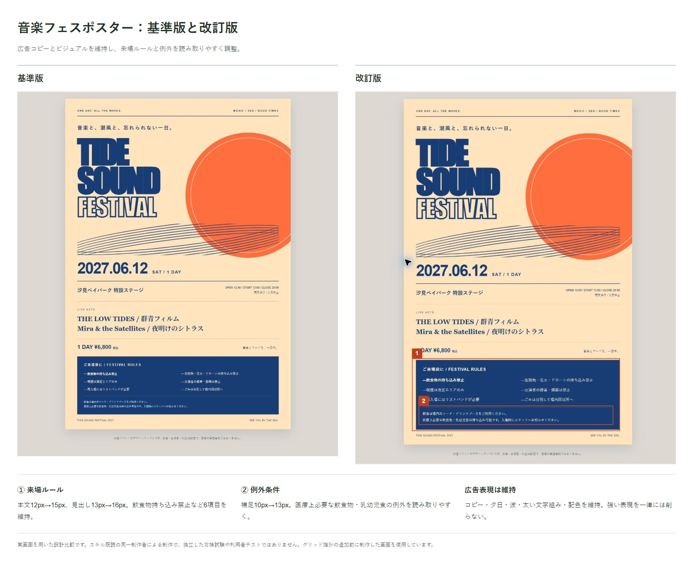

# ui-copy-and-controls

Codex向けの日本語スキルです。UIの文言・コントロール・装飾と操作の流れを、利用者の目的に照らして設計します。

文字数や装飾の少なさを目標にせず、必要な設定名・単位・出力形式・注意事項を残します。LPや広告の強いコピー、世界観を担う表現は一律に削除しません。

## 対象

- ゲーム、編集ツール、設定・ヘルプなどの操作画面
- 一覧・比較・完了画面など、主画面に付随するページ
- LPや広告内の操作案内、判断に必要な情報

角丸・配色・書体など、特定の見た目を一律に禁止するスキルではありません。

## UX方針

- 目的の操作を探しやすくし、今決める必要のない設定まで判断させない。
- 調整と結果確認の往復を減らし、倍率・位置・選択を保つ。
- 重い画像調整では軽量プレビューを追従させ、操作後に精細化する。プレビュー切替と設定のリセットを区別する。
- 状態・結果・次の操作を伝え、失敗理由と復帰方法を示す。
- 慣用アイコンや既習操作を活かし、反復クリック・無理な同時押し・持ち替えを減らす。
- PCの狭い参照ウィンドウ、編集画面、スマホなど、実際の作業環境で考える。

詳細は [UX方針](references/ux.md) にまとめています。この追加内容を使った制作・利用者テストは今後実施予定で、以下の既存比較画像は追加方針の検証結果ではありません。

## グリッドデザイン

列・余白・整列の基準を共有して、主役・操作・補足の関係を作ります。均等なカードや固定の列数を押し付けず、原稿と設定に必要な幅を割り当て、狭い画面でも読む順序を保ちます。LPやポスターの意図的な非対称やはみ出しは、訴求の役割があれば維持します。

## 使い方

1. このリポジトリを取得します。
2. Codexのユーザースキルディレクトリ `~/.codex/skills/ui-copy-and-controls/` に `SKILL.md` と `references/` フォルダを配置します。
3. UIの制作・修正依頼で `$ui-copy-and-controls` を指定します。

例：

> $ui-copy-and-controls を使い、漫画編集ツールの画面を整理してください。原稿を中心にし、線数・濃度・角度と保存形式は分かるように残してください。

自動選択時にも適用対象を判断できるよう、SKILL.mdのdescriptionに対象を記載しています。

## 基準版と改訂版の比較

同じ題材・素材を使った、整理前の画面と本スキルの考え方で整理した画面です。画像は左が基準版、右が改訂版。変更箇所に印と短い説明を付けています。

スキル既読の同一制作者による設計比較で、独立した盲検実験ではありません。利用者の理解度や作業時間の改善を実証するものではありません。

### ジャンプゲーム

常設の紹介文・遊び方を整理し、状態と再試行の意味を明示しました。月面の絵柄とゲームルールは共通です。

### 漫画用トーン化ツール

初期化の意味を明示し、文字色と原稿周辺の装飾を整理しました。画像変換・保存は未実装のUIデモです。

### 音楽フェスポスター

広告コピーとビジュアルは維持し、来場ルールと持ち込み例外の文字を大きくしました。架空イベントのデザインサンプルです。

## ファイル

- `SKILL.md`：スキル本体
- `references/ux.md`：操作の流れ・反応・身体的負担・作業環境の判断指針
- `*-comparison.jpg`：基準版と改訂版の比較例

## 検証範囲

改訂時にLP・比較一覧・編集ツール・ポスターの判断を独立エージェントで確認し、制作例はPC・スマホ相当の幅で検査しました。実機・Safari・利用者テストは未実施です。
